<p align="center">
  
</p>

<h1 align="center">Odin Hub</h1>

<p align="center">
  A console-style hardware and performance control center for the <b>AYN Odin 3</b> and <b>AYN Odin 2 Mini</b>.<br>
  Built by <b>dfdx047</b>.
</p>

<p align="center">
  <b>English</b> · <a href="./README.pt-BR.md">Português (Brasil)</a>
</p>

<p align="center">
  <a href="https://github.com/dfdx047/OdinHub/releases"></a>
  
  
</p>

<p align="center">
  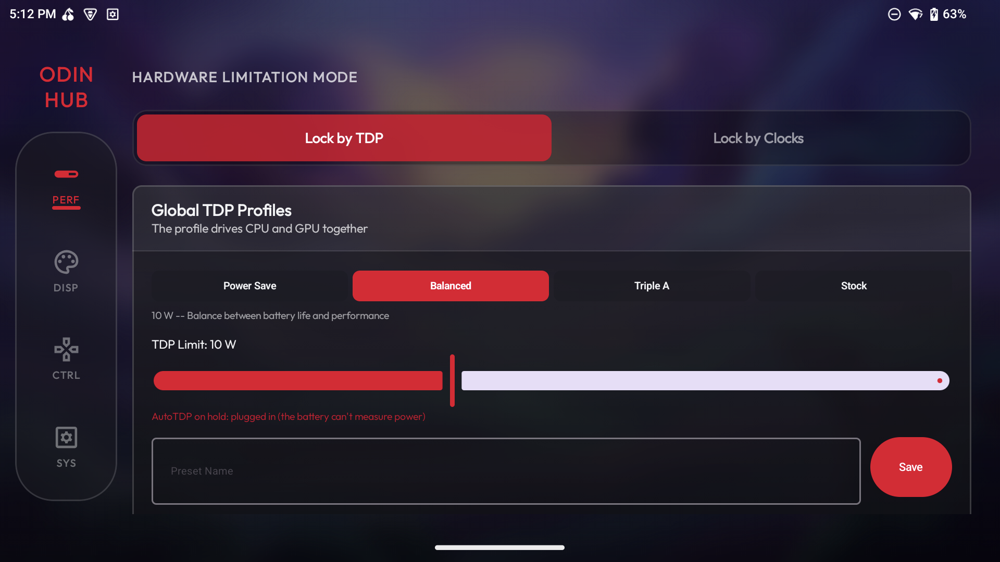
</p>

---

## What this is

The Odin 3 ships with a Snapdragon 8 Elite that is far more powerful than most Android games and emulators need. Left alone, it runs hot, drains the battery fast, and throttles — all to render a PS2 game that would have been happy with a third of that power.

Odin Hub is the layer that sits between you and that silicon. It lets you decide, **per game**, how much of the device to actually spend:

- Cap the CPU/GPU to a target power draw and hold it there.
- Or pin exact clock frequencies per CPU cluster when you want deterministic behaviour.
- Set the fan and display calibration to match.
- Save it all as a rule for that specific game — and have it applied automatically the moment the game opens, and reverted the moment you leave.

The goal is that you configure a game **once** and never think about it again.

## The core idea: per-game profiles

This is the feature everything else exists to serve.

```
You open GTA San Andreas
        │
        ▼
Odin Hub detects the foreground app
        │
        ▼
Looks up that game's rule in its database
        │
        ├── found     → applies 5 W cap, quiet fan, vibrant colors
        └── not found → applies your global profile
        │
        ▼
You leave the game → device returns to the global profile
```

Rules live in a single Room database and are edited from **two places that stay in sync**:

- **Per-App Overrides** screen — configure a game up front, from the couch.
- **In-game overlay** — a side handle you pull out mid-game, like a phone's "game mode" panel. Change the TDP while you play; the rule for that game is created or updated on the spot.

Change a game in one place and the other reflects it. There is no second source of truth.

## Screenshots

| | |
|---|---|
| 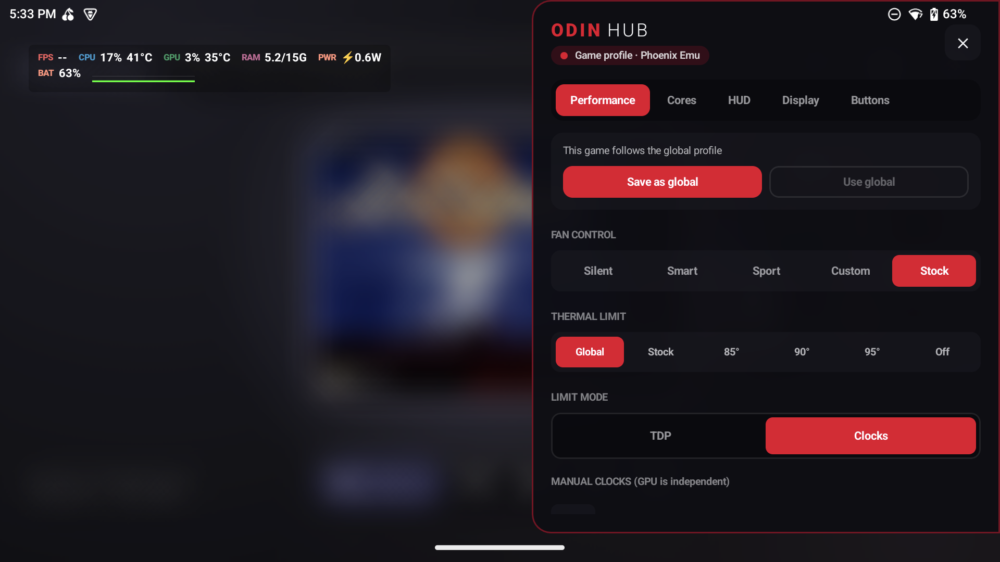 | 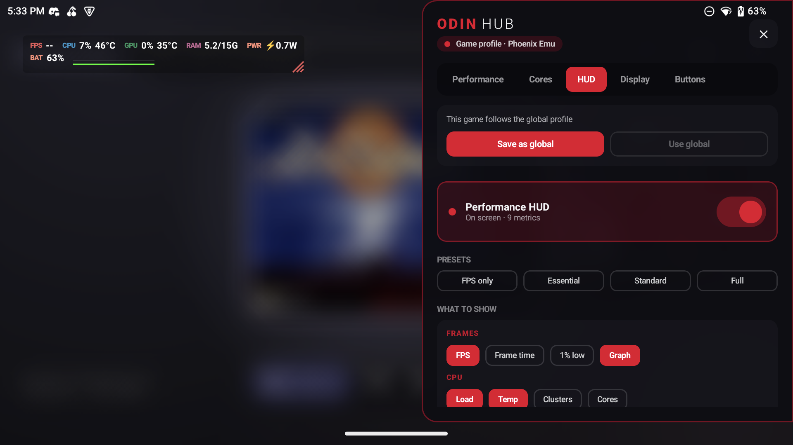 |
| **In-game overlay** — change the game's profile mid-game, or save it as the global one | **HUD tab** — turn the HUD on, pick a preset or each metric, live |
| 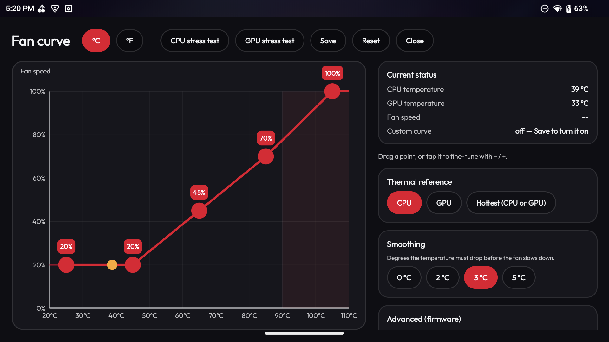 | 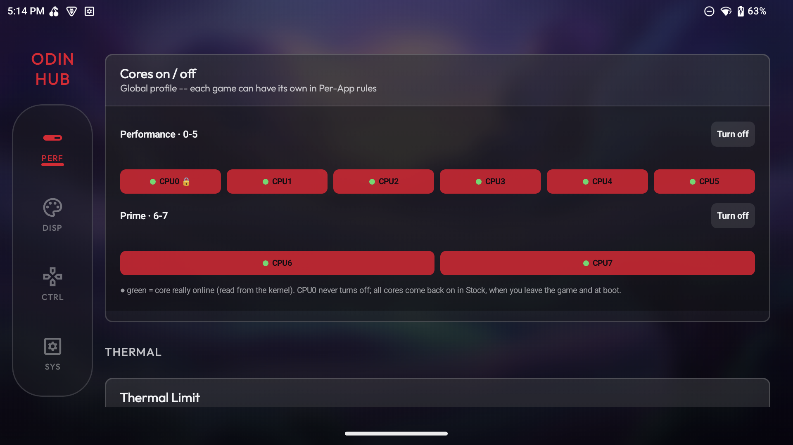 |
| **Custom fan curve** — drag the points, follow the CPU, the GPU or the hottest | **CPU cores on/off** — globally or per game; green = really online |
| 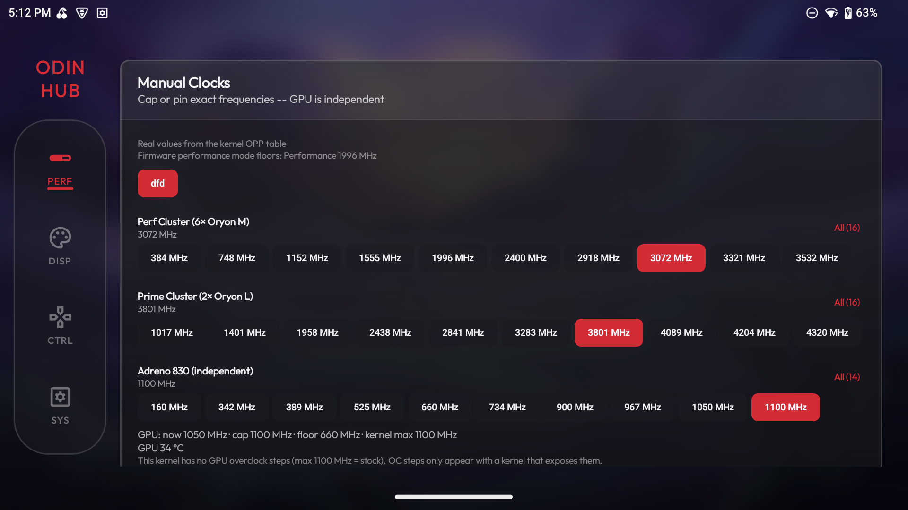 | 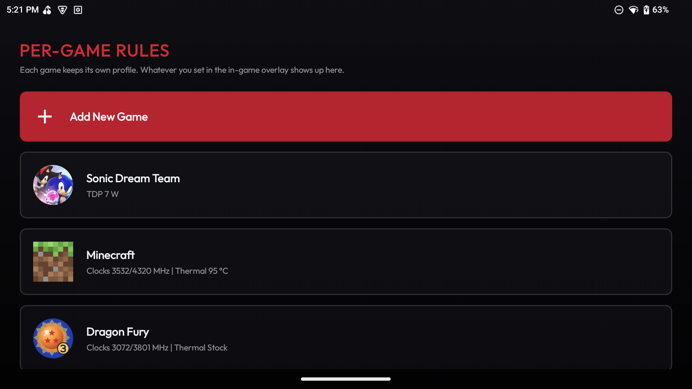 |
| **Real clock tables** — every chip is a frequency the Snapdragon 8 Elite actually supports | **Per-game rules** — applied when the game opens, reverted when you leave |
| 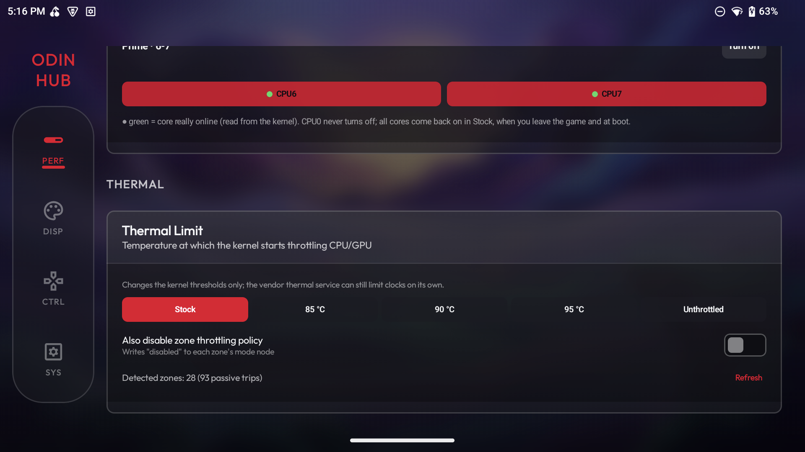 | 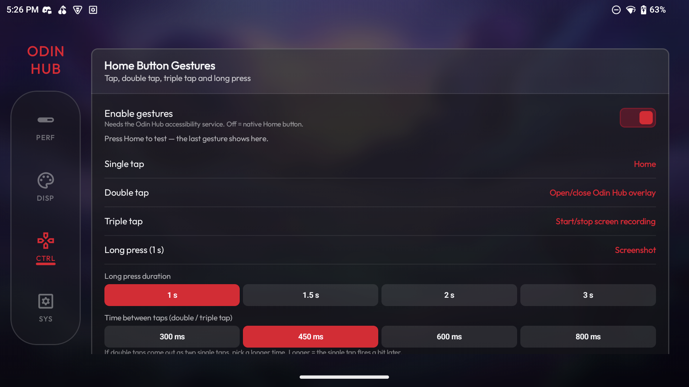 |
| **Thermal limit** — move the throttling point, globally or per game | **Home button gestures** — screenshot, full-screen recording, overlay… |
| 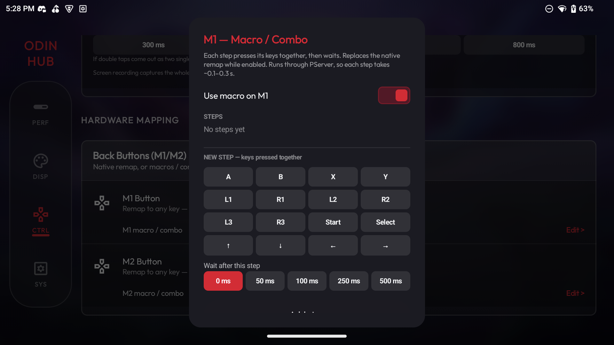 | 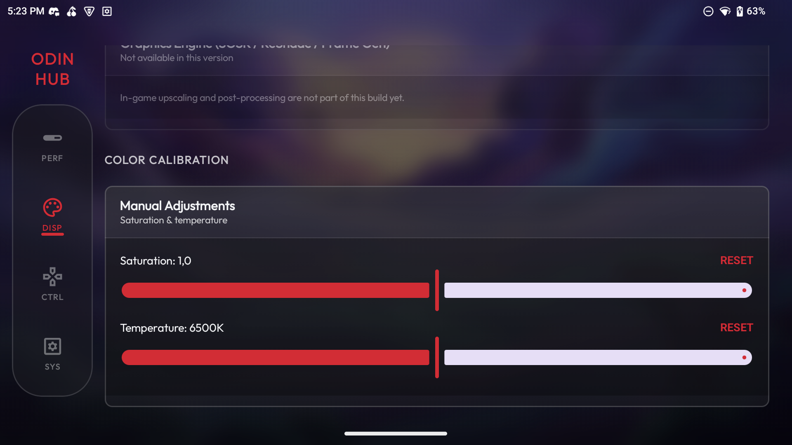 |
| **M1 / M2 macros** — combos and timed sequences, global or per game | **Color calibration** — saturation and white balance, live |

## Features

### Performance
- **Dynamic TDP (AutoTDP)** — a closed loop that measures real-time power draw on the battery and walks CPU/GPU clocks until the device settles at your target wattage. It filters the noisy battery reading, cuts fast when over budget and raises slowly when under (no saw-tooth stutter), and — when the GPU is the bottleneck — takes the cut from the CPU instead (and vice versa). It pauses while charging (the battery can't measure the device then) and with the screen off.
- **TDP profiles** — Power Save (7 W), Balanced (10 W) and Triple A (15 W), sized for the Odin 3's Snapdragon 8 Elite, plus Stock (no limit). The free slider goes up to 25 W. Profiles are independent from the slider.
- **Per-cluster clock control** — the real frequencies of both CPU clusters (6 Oryon cores and 2 Prime cores) and the Adreno 830, read live from the kernel's OPP tables, with the Odin 3's own table as fallback. Only one of TDP or manual clocks is active at a time.
- **Clock pinning** — pin a cluster or the GPU at its cap (floor = cap) for steady frame pacing.
- **CPU cores on/off** — turn cores off globally or per game, from Performance, the overlay's **Cores** tab or a per-game rule. The cards show which cores are really online. CPU0 never turns off, and every core comes back in Stock, when you leave the game and at boot.
- **Save as global profile** — one button in the overlay and in per-game rules copies the current settings to the global profile; **Use global** drops the game's own rule.
- **Thermal limit** — optionally move the first-stage passive trip points of the CPU/GPU thermal zones (85 / 90 / 95 °C or unthrottled), globally or per game. Written through PServerBinder like everything else — no KernelSU/Magisk needed. Emergency trips and **fan trips** are never touched, and Stock restores the factory values (the backup is tied to the current boot, so it can never "restore" a modified value).
- **Fan control** — Stock, Quiet, Smart and Sport, mapped to the Odin 3's real fan modes, plus a **custom fan curve**: drag the points on a graph (or fine-tune them with the D-pad), follow the CPU, the GPU or the hottest of the two, watch the live temperature and fan speed, and run CPU / GPU stress tests. At 90 °C or more the fan always runs at 100 %.
- **Saved profiles** — save the current settings (TDP or clocks, pinning, cores and fan) as a named profile, such as "Game Boy Advance". The profile in use is always marked **✓ ACTIVE**, even when you set the same values by hand. Link a profile to a game in the overlay or in per-game rules and it is applied every time the game opens; editing the profile updates every game linked to it.

### Display
- Saturation (0–2×) and color temperature (4000–9000 K, warmer or cooler) applied live through SurfaceFlinger's own color transform.
- Per-game color, from the Per-App Overrides screen or the in-game overlay.

### Controls
- Remap the M1 / M2 rear buttons to any key code — or to a **macro / combo** (several buttons at once, or a timed sequence). Macros can also be set **per game**, from the Per-App Overrides screen or the in-game overlay.
- **Home button gestures** — single, double, triple tap and long press, each mapped to a system action: screenshot, full-screen recording (no app picker, saved to Movies/OdinHub), overlay toggle, recents, notifications, lock screen and more.
- Bind a physical button to open the in-game overlay.

### Performance HUD
- A small MangoHud-style overlay over **any app**: real FPS from SurfaceFlinger, frame time (with a graph), CPU load and temperature, per-cluster or per-core clocks, GPU load / temperature / clock, RAM, power draw, battery % and temperature, TDP target and the time.
- **Everything is optional** — switch each metric on or off, or start from a preset (FPS only, Essential, Standard, Full). Horizontal bar or vertical panel, several styles, five anchor positions, smooth dragging, pinch or corner resize, adjustable background.
- **Controlled from the game** — the side overlay's **HUD** tab turns it on and off and changes presets, metrics, layout, style, position, size and background, with changes shown live.
- Follows the app's theme, including Glass mode. **Double-tap to hide**; bring it back from the side overlay, the Home gesture "Show/hide performance HUD", or Settings.
- Cheap: everything is read straight from sysfs (CPU load comes from the cores' idle time); only FPS / frame time needs one PServerBinder call per second. Sampling stops while the HUD is hidden or the screen is off.
- The horizontal bar always stays on **one straight line**, sized to its metrics, and never leaves the screen while you drag it. Optional **Active profile** metric shows the profile in use (the game's linked profile, the global one, or "Manual").

### Interface
- **Glass appearance** — a Liquid Glass–style mode that works on top of every theme: translucent surfaces with a light edge; the side overlay also blurs the game behind it when the system allows.
- **Auto-update** — Odin Hub checks GitHub for a newer release when you open it and every few hours in the background (with a notification), shows a pop-up with the release notes, downloads the APK and installs it in place through PServerBinder (or hands it to the Android installer).
- Themes in groups, with a visual picker: **Odin signature** (Odin Ruby, Odin Arctic, Odin Aurora, Elite Ember), **Vibrant** (Neon Grid, Arena Green, Vapor Blue, Royal Blue), **Retro** (16-bit, 8-bit) and **System** (Material You dynamic colors), plus an AMOLED black mode.
- D-pad navigable with haptic feedback and focus glow.
- Animated boot sequence, custom wallpapers, and an integrated BGM/SFX mixer.

## Supported devices

Odin Hub supports the **AYN Odin 3** and the **AYN Odin 2 Mini**. It detects the device on its own; clock tables, thermal zones, GPU control and TDP profiles are tuned for each one and were tested on the devices themselves.

| | Odin 3 | Odin 2 Mini |
|---|---|---|
| SoC | Snapdragon 8 Elite (SM8750) | Snapdragon 8 Gen 2 (QCS8550) |
| CPU | 6 Oryon cores (cpu0-5) + 2 Prime cores (cpu6-7) | 3× A510 (cpu0-2) + 2× A715 / 2× A710 (cpu3-6) + 1× X3 (cpu7) |
| GPU control | Adreno 830 (kgsl), up to 1100 MHz | Adreno 740 (kgsl), up to 692 MHz |
| Thermal limit | ✓ | ✓ |
| M1 / M2 | ✓ | — (the device has no rear buttons) |
| TDP profiles (Power Save / Balanced / Triple A / slider max) | 7 / 10 / 15 / 25 W | 4.5 / 6.5 / 9 / 12 W |
| Root | Not needed (PServerBinder) | **KernelSU** (or another `su`) |
| Tested firmware | 1.0.0.188 | 1.0.0.117 |

Notes:

- TDP figures are whole-device battery draw. The steps are deliberately far apart so the profiles actually feel different — tune to taste with the slider.
- The firmware raises each cluster's minimum frequency according to its own performance mode (perf HAL, `msm_performance`). When a cap goes below that floor, Odin Hub lowers the floor too, so the cap actually holds, and the app shows why when it can't.
- **Odin 2 Mini:** AYN's `pservice` rewrites the CPU and GPU caps *and* floors every time the performance mode changes. Outside Stock, Odin Hub sets its values and then makes those nodes read-only, so the firmware can't put its own back; Stock hands them back to the firmware. The device has its own theme (**Bubble Blue**) on a fresh install.
- Other devices (Odin 2, Thor, Retroid Pocket) are not supported. Use v0.13 on those.

## How it talks to the hardware

On the Odin 3, Odin Hub does not run `su` and needs no KernelSU/Magisk. It reaches a privileged helper already present on the device — `PServerBinder`, which runs as root — through `IBinder.transact()`, a technique pioneered by **ClusterTune** and **P.U.L.S.E.** (see Credits). Through that channel it writes to `sysfs` nodes and Android system settings. On the Odin 2 Mini, SELinux blocks apps from that helper, so Odin Hub uses one persistent `su` session instead (grant it root in KernelSU).

Two consequences worth knowing:

1. **Every write is verified, and only made when needed.** Before writing, the node is read directly (no root needed); if it already holds the value, nothing is sent. After writing, the value is read back and compared with what was there before — a write the kernel silently rejected is reported as a failure rather than assumed to have worked. In Stock mode the nodes are handed back to the system and left alone.
2. **Nodes are written independently.** An earlier design chained every node into one `cmd && cmd && cmd` string, so a single rejected node (a GPU clock locked by the bootloader, say) aborted every write after it. Each node now succeeds or fails on its own.

Foreground-app detection runs through an accessibility service, with a `UsageStatsManager` poll as a fallback so per-game rules and the overlay keep working even if that service is disabled.

## Requirements

- An AYN Odin 3 or AYN Odin 2 Mini.
- Odin 3: the `PServerBinder` helper available on the device (present on the stock AYN firmware). Odin 2 Mini: root through KernelSU (or another `su`), granted to Odin Hub.
- Permissions granted at first launch: **Usage Access** (foreground-app detection) and **Display over other apps** (the in-game overlay).

## Installing

1. Download the latest APK from the [Releases](https://github.com/dfdx047/OdinHub/releases) page.
2. Install it on your device.
3. Launch it and grant the two permissions it asks for.

After that, new versions show up inside the app (pop-up and notification) and install over the old one. Every version from v0.11 on is signed with the same key, so v0.14 installs over v0.11, v0.12 or v0.13 and keeps your settings and per-game rules. If you installed v0.10 or older, uninstall it once first: those builds were signed with a different key.

## Releasing

Releases are built and published **from the developer's machine**, not by GitHub Actions (CI only runs the tests and a debug build). This keeps every release signed with the same key, which Android requires to install an update over the previous version. By default that key is the machine's Android debug key (`~/.android/debug.keystore`), so there is nothing to set up. **Back that file up**: without it, the next release can't update over the installed one.

1. Raise `versionCode` and `versionName` in `app/build.gradle.kts`.
2. Add a `## vX.Y` section at the top of [`CHANGELOG.md`](./CHANGELOG.md), in English and Portuguese.
3. Commit, then run:

```bash
./scripts/release.sh
```

The script runs the tests, builds the release APK, creates and pushes the `vX.Y` tag, and publishes the GitHub release with the APK (`OdinHub-vX.Y.apk`) and that version's changelog section as the release notes. It needs the [GitHub CLI](https://cli.github.com/) signed in (`gh auth login`).

Optional: to use a dedicated key instead of the debug key, put a `keystore.properties` file (git-ignored) in the project root with `storeFile`, `storePassword`, `keyAlias` and `keyPassword`.

## Building

```bash
git clone https://github.com/dfdx047/OdinHub.git
cd OdinHub
./gradlew assembleDebug
```

Requires JDK 17 and the Android SDK (compileSdk 35, minSdk 33). Unit tests:

```bash
./gradlew testDebugUnitTest
```

## Architecture

Some structural decisions here are not obvious from the code, and re-learning them the hard way wastes time. If you are picking this project up, read this first.

### `PerformanceCommandBuilder` — why it exists

Hardware writes are built in one place rather than assembled ad hoc at each call site. It owns:

- **Dynamic cpufreq policy discovery.** Cluster layout varies by SoC and firmware, so policies are scanned at runtime instead of hardcoding `policy0` / `policy6`. The policy with the highest max frequency is treated as Prime.
- **Independent, verified writes.** Each node is one `HardwareWriteOp` that is applied, read back, and retried through a sequential fallback if the chained form failed.
- **A single place for the clamp ratios.** Notably, the floor for dynamic TDP is *lower* than the floor for manual clocks — low targets like 5 W need room to walk the clocks down far enough to actually converge.

`PerformanceManager.lastApplyStatus` exposes the result of the last write pass so the UI can show a real failure instead of trusting a write that never landed.

### `AppOverrideRepository` — the single source of truth

Per-game rules are read and written from very different contexts: a normal ViewModel screen, and a `WindowManager` overlay running outside the activity lifecycle. Both go through this repository, backed by one Room table.

It exposes a `StateFlow<Map<String, AppOverrideEntity>>` kept warm by a Room `Flow`, so the accessibility thread can read the current rule synchronously via `.value` without ever touching disk on that thread. **If you add a new per-game setting, it goes on `AppOverrideEntity`** — not into a new `SharedPreferences` key.

### `ForegroundAppTracker` — reactive, in-memory only

Which app is in the foreground is *momentary* information, so it lives in a `StateFlow` and is never persisted. The overlay observes it, which is what lets its Compose tree re-key per game — the overlay is created once and would otherwise stay frozen on whatever game was open when the service started.

### Threading rule

Every root call is blocking. Anything triggered by user interaction — a slider drag, a toggle, an app switch — must be dispatched to `Dispatchers.IO`, and continuous controls should debounce with a cancellable job. A blocking root call on the main thread is enough to freeze the app during startup or make a slider unusable.

## Credits

Odin Hub is a heavily reworked derivative of existing open-source work, and stands on it:

- **[OdinTools](https://github.com/langerhans/OdinTools)** by Maximilian Keller (langerhans) — the original foundation this project was forked from: app-override plumbing and quick-settings infrastructure.
- **[P.U.L.S.E.](https://github.com/keiretrogaming/pulse)** by keiretrogaming — the `PServerBinder` technique and the closed-loop AutoTDP concept that make deep hardware control possible without a traditional root setup.
- **[ClusterTune](https://github.com/AurelioB/ClusterTune)** by AurelioB — the original pioneer of the PServer sysfs approach.

## License

MIT. The original copyright notice is retained in [`LICENSE`](./LICENSE) as the license requires, alongside the copyright for this project's own work.
