<p align="center">
  
</p>

<h1 align="center">Odin Hub</h1>

<p align="center">
  Uma central de controle de hardware e desempenho, com cara de console, para o <b>AYN Odin 3</b>.<br>
  Feito por <b>dfdx047</b>.
</p>

<p align="center">
  <a href="./README.md">English</a> · <b>Português (Brasil)</b>
</p>

<p align="center">
  <a href="https://github.com/dfdx047/OdinHub/releases"></a>
  
  
</p>

<p align="center">
  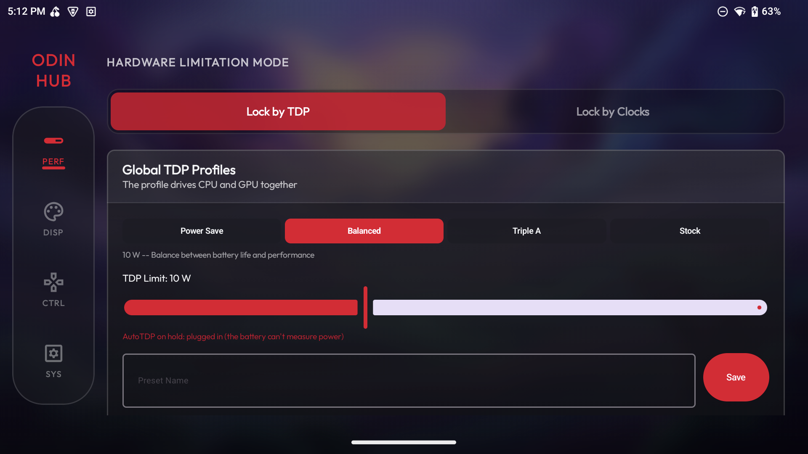
</p>

---

## O que é

O Odin 3 vem com um Snapdragon 8 Elite, muito mais potente do que a maioria dos jogos e emuladores Android precisa. Sem controle, ele esquenta, gasta a bateria rápido e entra em throttling. Tudo isso para rodar um jogo de PS2 que ficaria feliz com um terço dessa potência.

O Odin Hub fica entre você e esse chip. Ele deixa você decidir, **jogo a jogo**, quanto do aparelho gastar de fato:

- Limitar CPU/GPU a um consumo alvo e mantê-lo ali.
- Ou fixar frequências exatas por cluster de CPU, quando você quer um comportamento previsível.
- Ajustar a ventoinha e a calibração da tela a combinar.
- Salvar tudo como uma regra daquele jogo, aplicada sozinha quando o jogo abre e desfeita quando você sai.

A ideia é configurar um jogo **uma vez** e nunca mais pensar nisso.

## A ideia central: perfis por jogo

Este é o recurso que todo o resto existe para servir.

```
Você abre o GTA San Andreas
        │
        ▼
O Odin Hub detecta o app em primeiro plano
        │
        ▼
Procura a regra desse jogo no banco de dados
        │
        ├── achou     → aplica limite de 5 W, ventoinha silenciosa, cores vivas
        └── não achou → aplica o seu perfil global
        │
        ▼
Você sai do jogo → o aparelho volta ao perfil global
```

As regras ficam num único banco de dados Room e são editadas em **dois lugares que ficam sincronizados**:

- Tela **Configurações por Aplicativo**: configure um jogo com calma, antes de jogar.
- **Overlay no jogo**: uma alça lateral que você puxa no meio do jogo, como o painel "modo jogo" dos celulares. Mude o TDP enquanto joga; a regra daquele jogo é criada ou atualizada na hora.

Mude um jogo num lugar e o outro reflete. Não existe uma segunda fonte de verdade.

## Capturas de tela

| | |
|---|---|
| 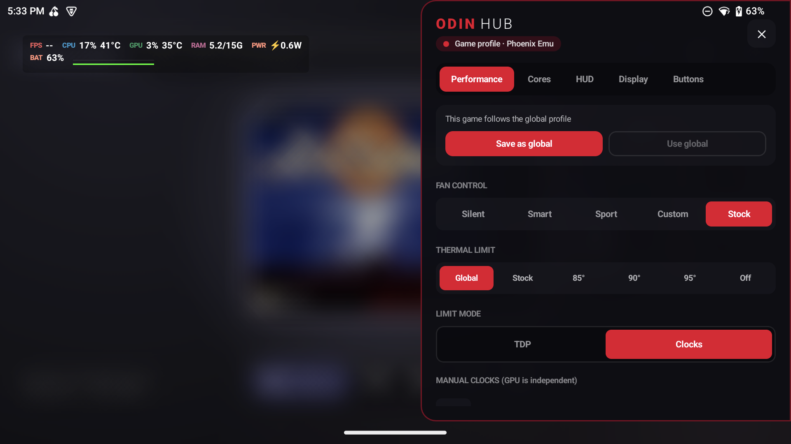 | 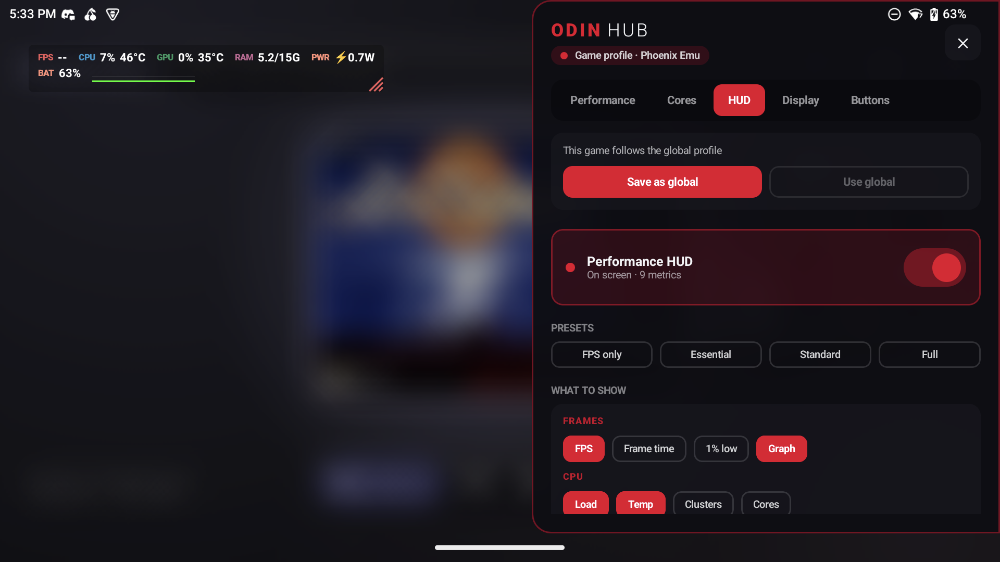 |
| **Overlay no jogo**: mude o perfil do jogo no meio da partida, ou salve como o global | **Aba HUD**: ligue o HUD, escolha uma predefinição ou cada métrica, ao vivo |
| 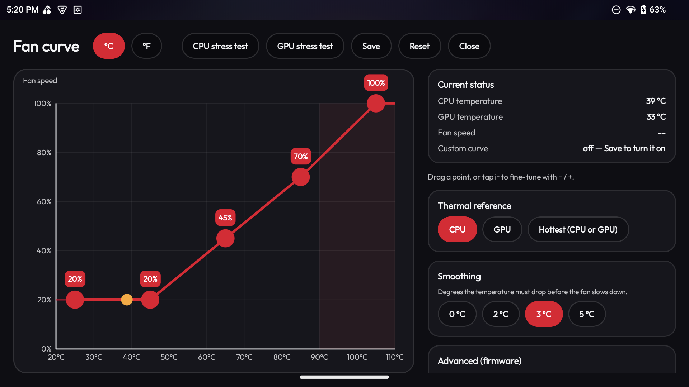 | 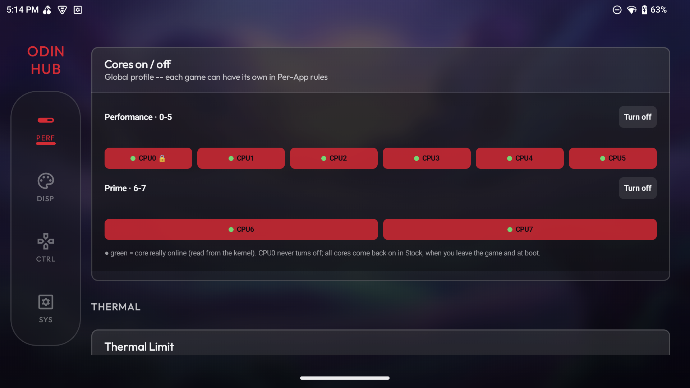 |
| **Curva da ventoinha personalizada**: arraste os pontos, siga a CPU, a GPU ou a mais quente | **Ligar e desligar núcleos**: no global ou por jogo; verde = realmente ligado |
| 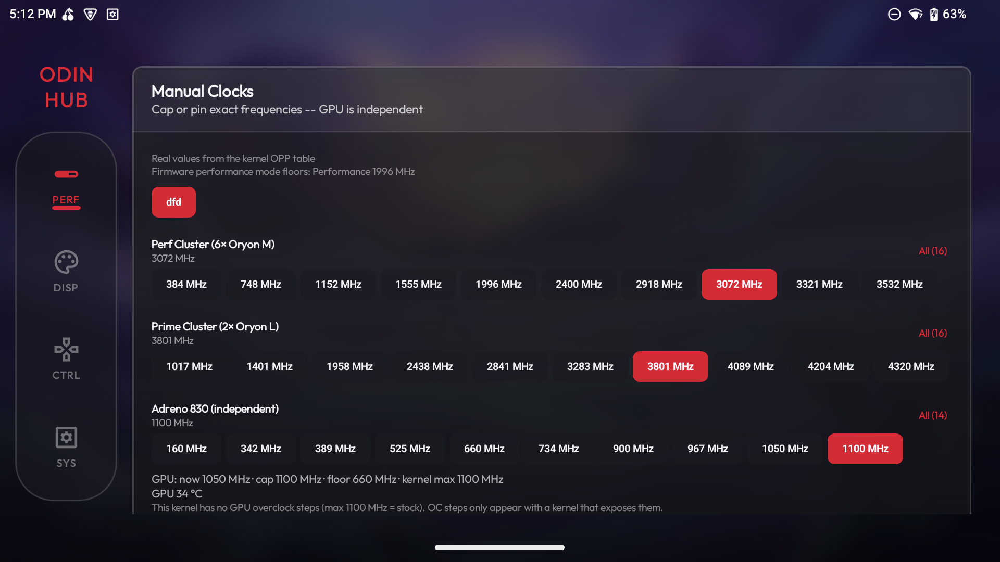 | 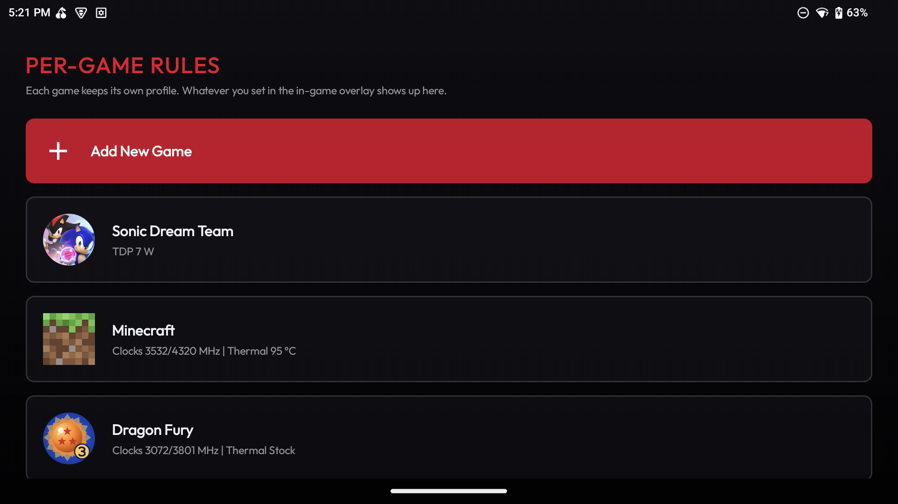 |
| **Tabelas de clock reais**: cada chip é uma frequência que o Snapdragon 8 Elite realmente suporta | **Regras por jogo**: aplicadas quando o jogo abre, desfeitas quando você sai |
| 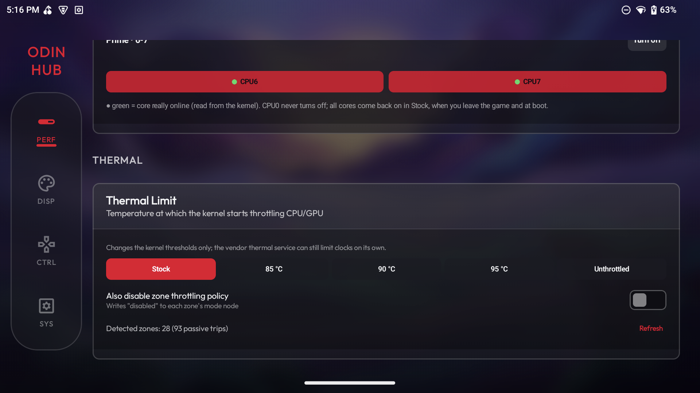 | 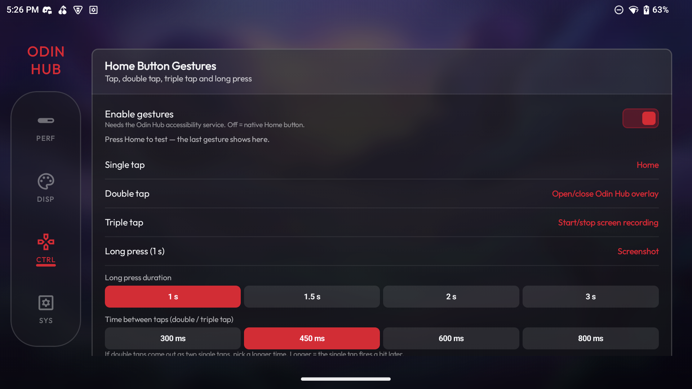 |
| **Limite térmico**: mude o ponto de throttling, no global ou por jogo | **Gestos do botão Home**: captura de tela, gravação da tela inteira, overlay… |
| 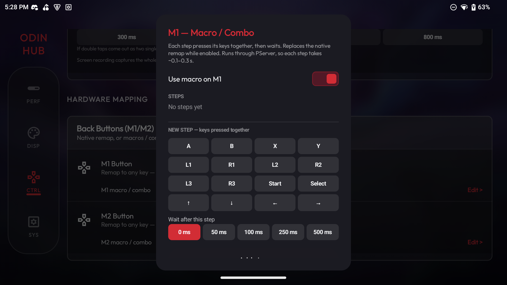 | 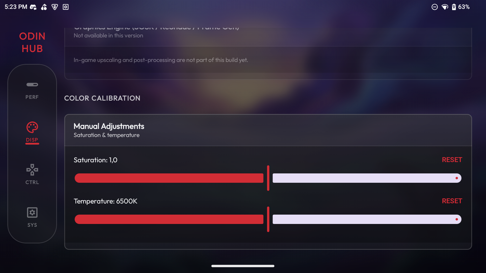 |
| **Macros M1 / M2**: combos e sequências temporizadas, no global ou por jogo | **Calibração de cor**: saturação e balanço de branco, ao vivo |

## Recursos

### Desempenho
- **TDP dinâmico (AutoTDP)**: um ciclo fechado que mede o consumo real na bateria e ajusta os clocks de CPU/GPU até o aparelho se estabilizar no consumo alvo. Ele filtra a leitura ruidosa da bateria, corta rápido quando passa do limite e sobe devagar quando sobra (sem engasgos em serra), e, quando a GPU é o gargalo, tira o corte da CPU (e vice-versa). Pausa durante a carga (a bateria não consegue medir o aparelho nessa hora) e com a tela desligada.
- **Perfis de TDP**: Economia (7 W), Equilibrado (10 W) e Triple A (15 W), dimensionados para o Snapdragon 8 Elite do Odin 3, mais Stock (sem limite). O slider livre vai até 25 W. Os perfis são independentes do slider.
- **Clock por cluster**: as frequências reais dos dois clusters da CPU (6 núcleos Oryon e 2 núcleos Prime) e da Adreno 830, lidas ao vivo das tabelas do kernel, com a tabela do próprio Odin 3 como reserva. Só um dos dois fica ativo de cada vez: TDP ou clocks manuais.
- **Fixar clocks**: fixa um cluster ou a GPU no teto (piso = teto), para um frame pacing estável.
- **Ligar e desligar núcleos da CPU**: desligue núcleos no global ou por jogo, pelo Desempenho, pela aba **Núcleos** do overlay ou por uma regra do jogo. Os cartões mostram quais núcleos estão realmente ligados. O CPU0 nunca desliga, e todos voltam no Stock, quando você sai do jogo e ao ligar o aparelho.
- **Salvar como perfil global**: um botão no overlay e nas regras por jogo copia os ajustes atuais para o perfil global; **Usar o global** apaga a regra própria do jogo.
- **Limite térmico**: opcionalmente, mude os primeiros pontos de throttling passivo das zonas térmicas da CPU/GPU (85 / 90 / 95 °C ou sem limite), no global ou por jogo. É escrito pelo PServerBinder como todo o resto, sem precisar de KernelSU/Magisk. Os pontos de emergência e os **da ventoinha** nunca são mexidos, e o Stock restaura os valores de fábrica (o backup é ligado ao boot atual, então nunca "restaura" um valor já modificado).
- **Controle da ventoinha**: Stock, Silencioso, Inteligente e Sport, ligados aos modos reais da ventoinha do Odin 3, mais uma **curva de ventoinha personalizada**: arraste os pontos num gráfico (ou afine pelo D-pad), siga a CPU, a GPU ou a mais quente das duas, veja a temperatura e a velocidade ao vivo e rode testes de stress da CPU e da GPU. A partir de 90 °C a ventoinha vai sempre a 100 %.
- **Perfis personalizados**: salve os seus próprios presets de TDP ou de clocks com um nome.

### Tela
- Saturação (0–2×) e temperatura de cor (4000–9000 K, mais quente ou mais fria), aplicadas ao vivo pela própria transformação de cor do SurfaceFlinger.
- Cor por jogo, pela tela de Configurações por Aplicativo ou pelo overlay no jogo.

### Controles
- Remapeie os botões traseiros M1 / M2 para qualquer código de tecla, ou para uma **macro / combo** (vários botões ao mesmo tempo, ou uma sequência temporizada). As macros também podem ser **por jogo**, pela tela de Configurações por Aplicativo ou pelo overlay.
- **Gestos do botão Home**: toque simples, duplo, triplo e longo, cada um ligado a uma ação do sistema: captura de tela, gravação da tela inteira (sem escolher app, sem áudio, salva em Movies/OdinHub), abrir o overlay, recentes, notificações, bloquear a tela e mais. O tempo entre toques é ajustável.
- Ligue um botão físico para abrir o overlay no jogo.

### HUD de desempenho
- Uma pequena sobreposição estilo MangoHud por cima de **qualquer app**: FPS real do SurfaceFlinger, frame time (com gráfico), uso e temperatura da CPU, clocks por cluster ou por núcleo, uso / temperatura / clock da GPU, RAM, consumo, bateria % e temperatura, alvo de TDP e hora.
- **Tudo é opcional**: ligue ou desligue cada métrica, ou comece por uma predefinição (Só FPS, Essencial, Padrão, Completo). Barra horizontal ou painel vertical, vários estilos, cinco posições, arrastar suave, redimensionar com pinça ou pelo canto, fundo ajustável.
- **Controlado de dentro do jogo**: a aba **HUD** do overlay lateral liga e desliga o HUD e muda predefinições, métricas, layout, estilo, posição, tamanho e fundo, com as mudanças em tempo real.
- Segue o tema do app, incluindo o modo vidro. **Dois toques escondem o HUD**; ele volta pelo overlay lateral, pelo gesto do Home "Mostrar/esconder HUD de desempenho" ou pelas Configurações.
- Leve: tudo é lido direto do sysfs (o uso da CPU vem do tempo ocioso dos núcleos); só o FPS / frame time precisa de uma chamada ao PServerBinder por segundo. A leitura para enquanto o HUD está escondido ou a tela está desligada.
- A janela cresce quando você adiciona métricas, e a barra horizontal quebra para uma segunda linha em vez de sair da tela.

### Interface
- **Aparência de vidro**: um modo estilo Liquid Glass que funciona por cima de qualquer tema, com superfícies translúcidas e borda de luz; o overlay lateral também desfoca o jogo por trás quando o sistema permite.
- **Atualização automática**: o Odin Hub procura uma versão nova no GitHub quando você o abre e a cada poucas horas em segundo plano (com notificação), mostra um pop-up com as novidades, baixa o APK e instala por cima pelo PServerBinder (ou passa para o instalador do Android).
- Temas em grupos, com seletor visual: **Assinatura Odin** (Odin Rubi, Odin Ártico, Odin Aurora, Brasa Elite), **Vibrantes** (Grade Neon, Verde Arena, Azul Vapor, Azul Real), **Retrô** (16-bit, 8-bit) e **Sistema** (cores dinâmicas do Material You), mais um modo AMOLED preto.
- Navegável pelo D-pad, com vibração e brilho de foco.
- Animação de boot, papéis de parede personalizados e um mixer de música de fundo e efeitos sonoros.

## Aparelho suportado

O Odin Hub é feito só para o **AYN Odin 3** (Snapdragon 8 Elite, 6 + 2 núcleos Oryon, Adreno 830). As tabelas de clock, as zonas térmicas, o controle da GPU e os perfis de TDP são ajustados para ele e foram testados no próprio aparelho (firmware 1.0.0.188).

| | Odin 3 |
|---|---|
| SoC | Snapdragon 8 Elite (SM8750) |
| CPU | 6 núcleos Oryon (cpu0-5) + 2 núcleos Prime (cpu6-7) |
| Controle da GPU | Adreno 830 (kgsl), até 1100 MHz |
| Limite térmico | ✓ |
| M1 / M2 | ✓ |
| Perfis de TDP (Economia / Equilibrado / Triple A / máx. do slider) | 7 / 10 / 15 / 25 W |

Notas:

- Os valores de TDP são o consumo do aparelho inteiro na bateria. Os degraus são bem separados de propósito, para os perfis fazerem diferença de verdade; ajuste a gosto com o slider.
- O firmware sobe a frequência mínima de cada cluster conforme o seu próprio modo de desempenho (perf HAL, `msm_performance`). Quando um limite fica abaixo desse piso, o Odin Hub baixa o piso também, para o limite valer de verdade, e o app mostra o motivo quando não consegue.
- Outros aparelhos (Odin 2, Thor, Retroid Pocket) deixaram de ser suportados. Neles, use a v0.13.

## Como ele fala com o hardware

O Odin Hub não roda `su` e não precisa de KernelSU/Magisk. Ele usa um auxiliar privilegiado que já existe no aparelho, o `PServerBinder`, que roda como root, através de `IBinder.transact()`, uma técnica criada pelo **ClusterTune** e pelo **P.U.L.S.E.** (veja os Créditos). Por esse canal ele escreve em nós do `sysfs` e nas configurações do sistema Android.

Duas consequências que vale a pena saber:

1. **Toda escrita é verificada, e só é feita quando precisa.** Antes de escrever, o nó é lido diretamente (sem root); se já tem o valor, nada é enviado. Depois de escrever, o valor é lido de volta e comparado com o anterior: uma escrita que o kernel rejeitou em silêncio aparece como falha, em vez de ser dada como feita. No modo Stock os nós são devolvidos ao sistema e deixados em paz.
2. **Os nós são escritos de forma independente.** Uma versão antiga encadeava todos os nós numa única string `cmd && cmd && cmd`, então um único nó rejeitado (um clock de GPU bloqueado pelo bootloader, por exemplo) cancelava todas as escritas seguintes. Agora cada nó dá certo ou falha sozinho.

A detecção do app em primeiro plano usa um serviço de acessibilidade, com uma consulta ao `UsageStatsManager` como reserva, para as regras por jogo e o overlay continuarem funcionando mesmo com esse serviço desligado.

## Requisitos

- Um AYN Odin 3.
- O `PServerBinder` disponível no aparelho (vem no firmware original da AYN).
- Permissões concedidas na primeira abertura: **Acesso ao uso** (detecção do app em primeiro plano) e **Sobrepor a outros apps** (o overlay no jogo).

## Instalação

1. Baixe o APK mais recente na página de [Releases](https://github.com/dfdx047/OdinHub/releases).
2. Instale no aparelho.
3. Abra e conceda as duas permissões que ele pede.

Depois disso, as versões novas aparecem dentro do app (pop-up e notificação) e instalam por cima da antiga. Todas as versões a partir da v0.11 são assinadas com a mesma chave, então a v0.14 instala por cima da v0.11, v0.12 ou v0.13 e mantém suas configurações e regras por jogo. Se você instalou a v0.10 ou anterior, desinstale-a uma vez antes: essas versões foram assinadas com outra chave.

## Como lançar uma versão

As releases são compiladas e publicadas **no computador do desenvolvedor**, não pelo GitHub Actions (o CI só roda os testes e um build de debug). Assim todas as releases saem assinadas com a mesma chave, que é o que o Android exige para instalar uma atualização por cima da versão anterior. Por padrão essa chave é a chave de debug do Android do computador (`~/.android/debug.keystore`), então não há nada para configurar. **Faça backup desse arquivo**: sem ele, a próxima release não instala por cima da que está instalada.

1. Suba `versionCode` e `versionName` em `app/build.gradle.kts`.
2. Adicione uma seção `## vX.Y` no topo do [`CHANGELOG.md`](./CHANGELOG.md), em inglês e português.
3. Faça o commit e rode:

```bash
./scripts/release.sh
```

O script roda os testes, compila o APK de release, cria e envia a tag `vX.Y` e publica a release no GitHub com o APK (`OdinHub-vX.Y.apk`) e a seção daquela versão do changelog como notas. Precisa do [GitHub CLI](https://cli.github.com/) com login feito (`gh auth login`).

Opcional: para usar uma chave própria em vez da chave de debug, coloque um arquivo `keystore.properties` (ignorado pelo git) na raiz do projeto, com `storeFile`, `storePassword`, `keyAlias` e `keyPassword`.

## Compilação

```bash
git clone https://github.com/dfdx047/OdinHub.git
cd OdinHub
./gradlew assembleDebug
```

Precisa do JDK 17 e do Android SDK (compileSdk 35, minSdk 33). Testes unitários:

```bash
./gradlew testDebugUnitTest
```

## Arquitetura

Algumas decisões de estrutura não são óbvias pelo código, e reaprendê-las do jeito difícil é perda de tempo. Se você vai mexer neste projeto, leia isto primeiro.

### `PerformanceCommandBuilder`: por que existe

As escritas no hardware são montadas num único lugar, em vez de improvisadas em cada chamada. Ele cuida de:

- **Descoberta dinâmica das políticas de cpufreq.** A organização dos clusters muda conforme o SoC e o firmware, então as políticas são procuradas em tempo de execução, em vez de fixar `policy0` / `policy6`. A política com a maior frequência máxima é tratada como Prime.
- **Escritas independentes e verificadas.** Cada nó é um `HardwareWriteOp` que é aplicado, lido de volta e repetido passo a passo se a forma encadeada falhou.
- **Um único lugar para os limites de proporção.** Em especial, o piso do TDP dinâmico é *menor* do que o dos clocks manuais: alvos baixos como 5 W precisam de espaço para descer os clocks o suficiente para estabilizar.

`PerformanceManager.lastApplyStatus` expõe o resultado da última passagem de escritas, para a interface mostrar uma falha real em vez de confiar numa escrita que nunca aconteceu.

### `AppOverrideRepository`: a fonte única de verdade

As regras por jogo são lidas e escritas em contextos muito diferentes: uma tela normal com ViewModel e um overlay de `WindowManager` que roda fora do ciclo de vida da activity. Os dois passam por este repositório, sobre uma única tabela Room.

Ele expõe um `StateFlow<Map<String, AppOverrideEntity>>` mantido atualizado por um `Flow` do Room, para a thread de acessibilidade ler a regra atual na hora via `.value` sem tocar no disco nessa thread. **Se você adicionar uma nova configuração por jogo, ela vai no `AppOverrideEntity`**, não numa nova chave de `SharedPreferences`.

### `ForegroundAppTracker`: reativo, só em memória

Qual app está em primeiro plano é uma informação *momentânea*, então fica num `StateFlow` e nunca é salva. O overlay observa esse estado, e é isso que deixa a árvore Compose dele se refazer para cada jogo: o overlay é criado uma vez só e, de outra forma, ficaria congelado no jogo que estava aberto quando o serviço começou.

### Regra das threads

Toda chamada root é bloqueante. Qualquer coisa disparada pelo usuário (arrastar um slider, um interruptor, uma troca de app) tem de ir para `Dispatchers.IO`, e os controles contínuos devem ter debounce com um job cancelável. Uma chamada root bloqueante na thread principal basta para travar o app na abertura ou deixar um slider inutilizável.

## Créditos

O Odin Hub é um derivado muito retrabalhado de projetos open source já existentes, e se apoia neles:

- **[OdinTools](https://github.com/langerhans/OdinTools)**, de Maximilian Keller (langerhans): a base original de onde este projeto foi bifurcado, com a estrutura das regras por app e dos atalhos rápidos.
- **[P.U.L.S.E.](https://github.com/keiretrogaming/pulse)**, de keiretrogaming: a técnica do `PServerBinder` e o conceito de AutoTDP em ciclo fechado, que tornam possível o controle profundo do hardware sem o root tradicional.
- **[ClusterTune](https://github.com/AurelioB/ClusterTune)**, de AurelioB: o pioneiro da abordagem do PServer com o sysfs.

## Licença

MIT. O aviso de copyright original é mantido em [`LICENSE`](./LICENSE), como a licença exige, junto com o copyright do trabalho deste projeto.
